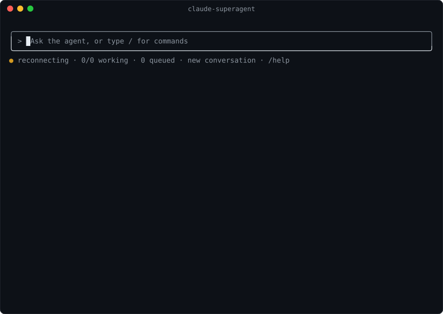
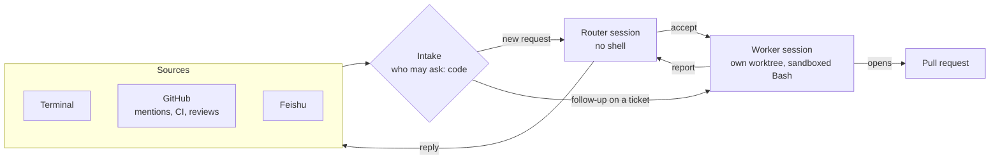
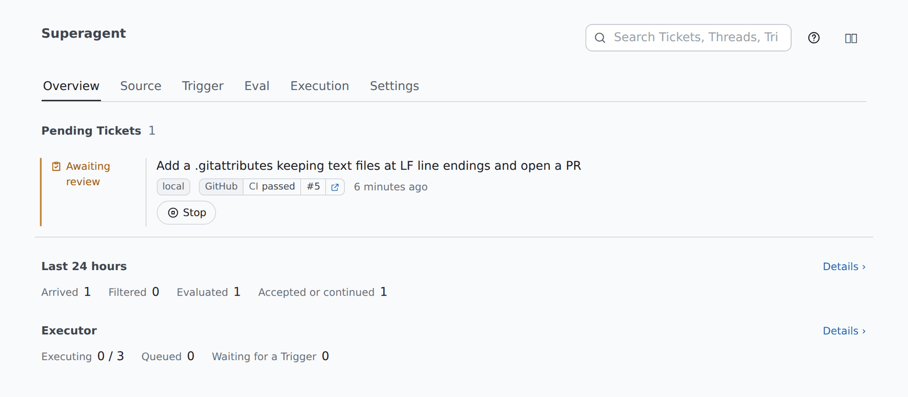
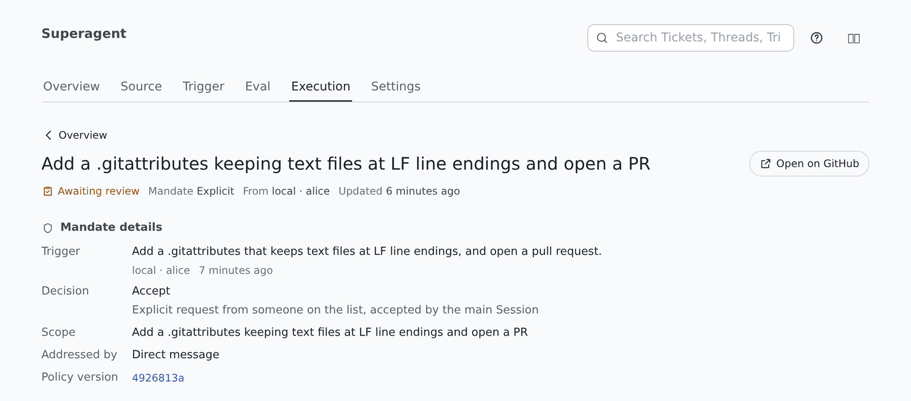

<div align="center">

# claude-superagent

**An always-on Claude Code agent for one GitHub repository.**

Ask for work from your terminal or on GitHub. It opens a ticket, does the work in a git worktree of its own,<br>and answers in the same conversation, usually with a pull request.

[](https://github.com/lyra-planet/claude-superagent/actions/workflows/ci.yml)
[](LICENSE)
[](https://nodejs.org)
[](tsconfig.json)
[](https://code.claude.com/docs/en/agent-sdk/overview)
[](https://github.com/deepseek-ai/dsh-superagent-prototype)



<sub>A real run on a test repository, recorded from the terminal; the waits for the model are shortened.</sub>

</div>

## What it does

- **Takes requests where people already are.** The interactive terminal, `@`-mentions on GitHub issues and pull requests, and optionally Feishu chats.
- **Lets code decide who may ask, and the model decide what is work.** Allowed lists, an admission table and an accept mode are checked in code; the router session judges whether a message asks for work.
- **Gives each ticket its own worker.** One Claude Code session and one git worktree per ticket, so several run side by side without stepping on each other.
- **Sends follow-ups straight to the worker.** A comment on its pull request, a CI failure, a review or a reply in the terminal reaches the worker that owns the ticket, without another routing decision.
- **Keeps its rules in code.** A `PreToolUse` hook stops a worker from merging its own pull request, deleting things on GitHub or reading credentials, whatever the prompt says. Bash runs in Claude Code's sandbox.
- **Survives restarts.** Side effects are recorded before they run and ids come from their inputs, so a restarted service picks up where it stopped without repeating work.
- **Lets you step in.** `/open` hands you a worker's session in Claude Code itself; when you leave, the worker reads what you did and carries on.

## How it works



The domain core (tickets, decisions, admission, the effect queue) is [dsh-superagent](https://github.com/deepseek-ai/dsh-superagent-prototype)'s, unchanged but for one rule about follow-ups. What changed is the host: the sessions run on Claude Code through the [Claude Agent SDK](https://code.claude.com/docs/en/agent-sdk/overview) instead of the DeepSeek Harness.

| | dsh-superagent | claude-superagent |
|---|---|---|
| Host | DeepSeek Harness | Claude Code, through the Agent SDK |
| Router | has `bash`; "don't do the work" is prompt text | no built-in tool but `Skill` (`tools: ['Skill']`) |
| Rules such as "never merge your own PR" | prompt text and command shims | also a `PreToolUse` hook the worker cannot get past |
| Shell isolation | none (`danger-full-access`) | Claude Code's Bash sandbox, `on`, `weak` or `off` |
| Following and steering the agent | DSH's UI, where the panel opens a session | a terminal drawn as Claude Code's, and `open`, which hands a worker's session to you in Claude Code |
| Asking for work without a second account | no | the terminal Source |

Upstream's host tests are ported and pass against this host: a message reaches a session once and counts as read when a step takes it, a turn ends when the session goes idle, a worker that hands off frees its slot. Two things Claude Code does differently: a background job that ends wakes its worker, and a person's message waits for a long foreground command to finish. [docs/003-execution.md](docs/003-execution.md) has the details, and [docs/host-probes.md](docs/host-probes.md) the measurements behind them.

## The panel

Everything the terminal shows is also on a web panel at `http://127.0.0.1:3082/`, with the settings: Sources, who may ask, proactive rules, the prepare command, the worker model and concurrency, the sandbox and the prompts.

<p align="center">

<br><sub>Overview: what waits for a person, and the last day</sub>
</p>

<p align="center">

<br><sub>A ticket: who asked, and why it was accepted</sub>
</p>

## Quick start

You need Node.js 22.19 or later, git 2.32 or later, the GitHub CLI `gh` 2.48 or later with a GitHub account for the agent (write access to the repository), and Claude Code credentials. For the sandbox, `bubblewrap` and `socat` on PATH.

```sh
git clone https://github.com/lyra-planet/claude-superagent && cd claude-superagent
npm install --legacy-peer-deps      # also builds the panel and the terminal

git clone https://github.com/acme/widgets ~/src/widgets   # the checkout each ticket's worktree comes from
./bin/claude-superagent.mjs init --repo acme/widgets --gh ~/.local/bin/gh-agent \
  --clone ~/src/widgets --operator alice --sandbox on
./bin/claude-superagent.mjs         # the terminal; it offers to start the service in the background
```

<details>
<summary><b>Give the agent its own <code>gh</code></b></summary>

The service calls `gh` as the agent's account only, through a wrapper:

```sh
cat > ~/.local/bin/gh-agent <<'EOF'
#!/bin/sh
GH_CONFIG_DIR="$HOME/.config/gh-agent" exec gh "$@"
EOF
chmod +x ~/.local/bin/gh-agent
gh-agent auth login          # sign in as the agent account
gh-agent api user --jq .login
```

`npm 10.9` crashes on this tree's peer dependencies without `--legacy-peer-deps`.

</details>

<details>
<summary><b>Which Claude credentials</b></summary>

Use an `ANTHROPIC_API_KEY` (or a cloud provider) for anything that serves a team. Anthropic does not allow third-party products to offer claude.ai login or its rate limits ([Agent SDK overview](https://code.claude.com/docs/en/agent-sdk/overview)); a personal login is for your own use only.

</details>

`init` writes `~/.claude-superagent` (or `--state <dir>`): `config.json` with the port (3082), and the database with the settings. From GitHub, an account on the allowed list comments `@<agent login> <request>` on an issue or pull request. The agent takes no requests from its own account.

## The terminal

`claude-superagent` without a command opens a terminal drawn as Claude Code's own. What you type goes to the agent in the current conversation; its replies, its tickets' changes and each step their workers take appear as they happen.

| Command | What it does |
|---|---|
| `/tickets` | list the tickets, numbered |
| `/open <n>` | hand ticket n's worker session to you in Claude Code: once its turn ends (`/open <n> now` cuts it short) you work in it with the worker's git; when you leave, the worker has it again and reads what you did at its next turn |
| `/fork <n>` | open a copy of the worker's session in Claude Code, leaving the worker alone |
| `/new`, `/threads`, `/thread <n>` | start, list and switch conversations |
| `/stop <n>`, `/retry <n>`, `/pause`, `/resume` | as the panel's buttons |
| `/activity`, `/status`, `/panel`, `/help` | hide or show the workers' steps, the service's load and health, where the panel is, all commands |
| `/quit`, `/shutdown` | leave (the service goes on), or stop the service and leave |

<details>
<summary><b>Service commands</b></summary>

```sh
./bin/claude-superagent.mjs start --detach     # in the background, with a log per run in <state>/logs (start alone runs in the foreground)
./bin/claude-superagent.mjs stop               # waits for the workers; a scheduled check with --respect-stop leaves it stopped
./bin/claude-superagent.mjs restart
./bin/claude-superagent.mjs status             # exits 0 ok, 1 not running, 2 a part reports an error, 3 setup waits
./bin/claude-superagent.mjs check --respect-stop   # for cron: start it unless it runs or a person stopped it
./bin/claude-superagent.mjs logs -f
./bin/claude-superagent.mjs ask --wait "Please also ..."    # --thread <id> continues a conversation
./bin/claude-superagent.mjs inbox [<id>]
./bin/claude-superagent.mjs tickets
./bin/claude-superagent.mjs open <ticket> [--now | --fork]
```

The service listens on 127.0.0.1 only. To open the panel from another machine, forward the port (`ssh -L 3082:127.0.0.1:3082 <host>`), or put it behind a gateway that serves it under a path, such as code-server's `/proxy/3082/`, and allow the Host the gateway forwards: `init --allow-host <host>`, or `allowedHosts` in `config.json` and a restart. A request for any other Host gets a 403 that names it, and the log says the same once.

</details>

## Rules it keeps

- Workers run in `dontAsk` mode: what is not allowed is denied, never prompted.
- A `PreToolUse` hook ([src/app/hooks.ts](src/app/hooks.ts)) denies, with a reason the worker reads: merging or enabling auto-merge as the agent, deleting or reconfiguring anything on GitHub, `gh auth`, reading credential files, posting to chats directly, signalling processes, the commands the panel blocks, and any tool call once its ticket ended.
- The sandbox setting decides Bash: `on` runs it in Claude Code's sandbox, `weak` in its weaker mode for containers that cannot mount `/proc` (files and network stay in, other processes' `/proc` does not), `off` runs it as the service's user. Sandboxed Bash reaches GitHub and the domains listed in the panel (Execution → other domains the sandbox reaches), such as a package registry the tests need. The hook applies in every mode.
- None of this is a boundary against a determined program: run the service as an OS user that holds only the agent's credentials, and know that a worker's commands see the service's environment.
- Workers commit as the agent account with a plain `git commit`: the host sets the identity, since Claude Code refuses `git -c` without asking. They hand commands their text in files (`--body-file`, `git commit -F`), written outside the checkout.
- Every Claude Code process it starts reads no settings, hooks or skills of yours (`settingSources: []`) and keeps its sessions in the state directory. A worker's process gets the service's environment without credential-shaped variables, except those Claude Code signs in with; where the default sandbox runs, set `CLAUDE_CODE_SUBPROCESS_ENV_SCRUB=1` for the service to keep those out of worker commands too.

## Documentation

Read the numbered documents in order; each builds only on the ones before it.

| | |
|---|---|
| [000 Philosophy](docs/000-philosophy.md) | take as little human attention as possible, and give as much value as possible |
| [001 Domain model](docs/001-domain.md) | Sources, Triggers, Threads, Tickets, and the rules each one keeps |
| [002 Authorization](docs/002-authorization.md) | who may start work, and what that work may include |
| [003 Execution](docs/003-execution.md) | a Ticket through execution, delivery and recovery; the sandbox and the hook |
| [004 Prompts](docs/004-prompts.md) | what the agents read, what a team can edit, and when a change applies |
| [005 Panel](docs/005-panel.md) | the web panel, its tabs and settings |
| [006 Deployment](docs/006-deployment.md) | install, configure, run, upgrade and troubleshoot |
| [007 Architecture](docs/007-architecture.md) | the code, and where upstream's host went |
| [008 Cookbook](docs/008-cookbook.md) | adding a Source |

## Develop

```sh
npm run check        # typecheck, tests (upstream's, ported onto a stand-in Claude Code in tests/fixtures/claude.ts) and builds
node --experimental-strip-types --no-warnings poc/host-probes.ts text:weak:allow    # a host probe; calls a model
```

## License

MIT. Much of this repository comes from [dsh-superagent-prototype](https://github.com/deepseek-ai/dsh-superagent-prototype) by the DeepSeek Harness Team, also MIT; [NOTICE.md](NOTICE.md) lists what came from it and what changed.
