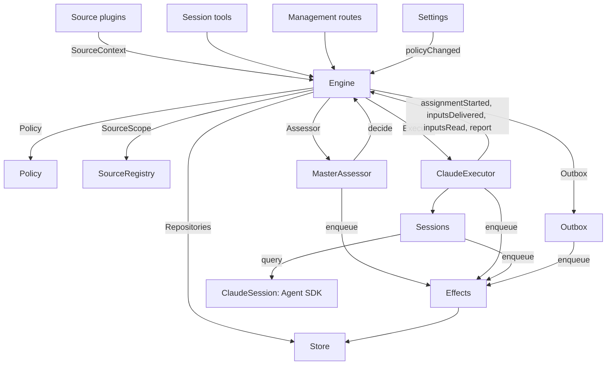

# 007 Architecture

This is the developer guide to the implementation. It maps the concepts in [001 Domain model](001-domain.md) through [006 Deployment](006-deployment.md) to classes, interfaces and files. Start with the runtime and Engine, then use the module and test tables as a code index. `NOTICE.md` says which files come from upstream and how they changed.

## Core classes and glue

Core classes own domain concepts and external boundaries behind small interfaces. Glue translates tool arguments, HTTP requests, Source payloads and Agent SDK messages into calls to those classes, then turns results into cards, views and messages.

`Runtime` (`src/app/runtime.ts`) constructs the application, supplies dependencies, and owns startup and shutdown. `Engine` constructs its own internal parts. The Executor and Assessor call back into the Engine, so Runtime gives them getters rather than requiring construction in a circular order.

### Runtime

`Runtime` is the composition root; it contains no domain rules. Its constructor locks the state directory (`proper-lockfile`, `<stateDir>.lock`), opens the Store and builds each component. If construction fails, it closes the Store and releases the lock. A lock that another process takes over aborts the Runtime.

`start` listens on the management port first, so the panel can show what setup still needs, then runs Setup. While setup waits, the Sources' loops start and report it, and nothing else does. After setup resolves, it syncs the Policy parts that sync, starts the Sources' loops, resumes interrupted Assignments (`ClaudeExecutor.resume`), and starts passes and effects. `ready` marks completion of startup. The router's Session opens on its first message.

`stop` marks the Runtime closing, stops passes and aborts its lifetime, cuts every running turn short, drains the effects and the Sources' loops, stops the workers' background work (`ClaudeExecutor.shutdown`), ends every Session's query, closes the server, restores the process environment, closes the Store and releases the lock. `src/cli.ts` restarts in the same process by stopping one Runtime and starting another on the same state directory, which Settings asks for after an account change.

The Runtime is the `SourceHost` that Source kinds receive for their Policy syncs and display names, and it runs each `SourcePlugin`'s loop with that kind's `SourceContext`. It also holds the management server: the API (`src/app/http.ts`), the terminal Source's routes, the terminal's own routes (`/local/events`, `/local/tickets…`), and the built panel; and a bus of live events (`LiveEvent`) the terminal follows.

| Part | Module | Does |
| --- | --- | --- |
| Setup | `src/app/setup.ts` | Resolves the repository and the accounts by probing their CLIs the way worker shells run them, writes and applies the workers' environment and command shims, and keeps the setup problems; Settings checks a changed account through it, and restarts through it, which runs setup again |
| Passes | `src/app/passes.ts` | One pass at a time, every two seconds and whenever a command asks: the due effects, then `Engine.evaluateDue`; a Source's Trigger reaches the Engine through it |
| Outbox | `src/app/outbox.ts` | The Engine's `Outbox` port, and the only writer of the receipts: `send` keeps a message's receipt and queues its `reply` effect in one transaction, and the effect's handler sends it through `SourceRegistry.send`; a message waits while its Source is off, and is dropped when the conversation is gone or not listened to |
| Notices | `src/app/notices.ts` | Converts domain events and worker activity into main-Session messages. `eventNotice` handles domain notices; `reportRelay` forwards questions immediately, keeps ordinary progress on its Ticket, and relays other reports; `followupNotice` names the Tickets that own a human follow-up. Relays are delivered with `priority: "next"`, so those arriving during a turn are taken at its next step |

### Engine

`Engine` (`src/core/engine.ts`) is the only writer of Triggers, Threads, Decisions, Tickets and Assignments. It receives these ports from `src/core/ports.ts`: `Repositories`, a current-Policy getter, `SourceScope`, `Assessor`, `Executor` and `Outbox`. Optional dependencies are `prepareTicket`, `now` and `emit`. The core is upstream's; the one change is the Policy port's `owns` and its use in `Intake` ([002 Authorization](002-authorization.md)).

All Engine methods are synchronous. Each command changes its aggregates in one transaction. `evaluateDue` uses a separate transaction for each Eval or Ticket it changes. Ports enqueue external work inside the transaction; adapters perform it after commit. Invalid requests throw `UserError`.

The Engine exposes one entry point and delegates to five internal parts. It owns each command's transaction. Commands spanning parts, such as `attach`, `evaluateDue` and `policyChanged`, call the parts in sequence.

Each part extends `EnginePart` (`src/core/part.ts`), which provides options and shared reads. Dependencies between the parts flow in one direction:

| Part | Responsibility | Depends on |
| --- | --- | --- |
| `Intake` | A Source's Trigger: stored once with its disposition, recorded on its Threads and their correlations, fanned out to the subscribed Tickets, as context only when the Policy does not let its sender own follow-ups, and, unless it is a person's message that a Ticket owns, queued for Eval on its primary Thread | Tickets |
| `Evals` | The Evals of Threads: batching, the gate's strength, actor and basis with the Trigger that gave them (`primary`), the deadline from the candidate's delivery and its shift by a pause, the requeue of an expired Eval, candidates, replays and hand-backs, the requeue on a Policy change, and the Decision each ends with: accept, stop, ignore or unavailable | Tickets |
| `Tickets` | The Ticket lifecycle: creation from an accept with its Mandate, Subscriptions and first Assignment, the Threads it follows and their closes (`followsDone`), attached Threads and Threads followed for context, Inputs and notes, resume and the messages a resume refuses, retry, restart, stop and end, the Subscriptions it drops, and the notice of a Policy change to the Tickets it bears on | Replies |
| `Assignments` | What the Executor and its workers report: an Assignment started, Inputs reached it or failed to, a restart interrupted it, and a worker's Report with its question for a person | Tickets, Replies |
| `Replies` | Channel writes through the `Outbox`: the acknowledgement, the answer, the result and the attention message, each by the rule that allows it | Nothing |

Commands use imperative names such as `stopTicket`; facts reported by adapters use past-tense names such as `assignmentStarted`. The query `candidate` uses a noun.

Callers receive only their role's `Pick` of the Engine: `EngineForSources`, `EngineForMainSession`, `EngineForPeople`, `EngineForSettings` or `EngineForExecutor`.

| Role | Method | Effect |
| --- | --- | --- |
| Sources | `receive(trigger)` | Stores a Trigger once and answers `stored`, `duplicate`, or `filtered` when no Source receives it; fans it out to the Tickets subscribed to its Threads, where the message of a person who owns follow-ups resumes an ended Ticket at once unless processing is paused, and queues it for Eval on its primary Thread, unless it is a person's message that a Ticket owns, which stays that Ticket's |
| Sources | `bindThread(ticketId, thread, own)` | Makes an open Ticket follow one of the Source's Threads, such as a pull request's, `own` when the Ticket opened it; a closed Thread bound again is open again. The Threads' closes, not a `ready` Report, end the Ticket |
| Sources | `threadClosed(thread, outcome, at)` | A Thread closed: each open Ticket that follows it records the close, and ends once it is done with the Threads it follows (`followsDone`): no Thread it opened is open, or, when it opened none, every Thread it follows closed. It ends `merged` or `closed` as the latest of those closes did, unless work resumed after the close has not reported `ready`, or its Executor took up, by acknowledging or answering it, a person's follow-up it decides after its latest Report other than `progress`, or the end of its last turn; a `dropped` Report then ends it as the close did |
| Main Session | `candidate(triggerId)` | The Eval that holds a Trigger, as its assessor sees it |
| Main Session | `candidateDelivered(evalId)` | The Eval's candidate reached the main Session: its deadline counts from now |
| Main Session | `decide(triggerId, outcome)` | Records an Eval Decision, or a direct Decision for an explicit request. Accept creates the Ticket, Mandate, Assignment, Subscriptions and acknowledgement atomically. An inferred candidate ignored from its card records `ignoredFromCard` before the supplied reason. While `followupOwners` still owns a human follow-up, only stop is allowed |
| Main Session | `attach(ticketId, triggerId, note?)` | Routes a Trigger to a Ticket it points at, whose Executor then decides it as a follow-up, and ends the Eval that holds it, whose other Triggers wait for a fresh Eval; an ended Ticket resumes under its Mandate at once unless processing is paused. A follow-up an Executor still decides is refused, as is one routed back to the Ticket that handed it back |
| Main Session | `requestStatus(ticketId)` | Asks a waiting Executor Session for its status, and answers whether it asked |
| Main Session | `note(ticketId, text)` | Gives a Ticket's Executor a fact from other work as a text Input, which grants nothing |
| Main Session, Executor | `reply(request)` | Queues a message for the Channel its purpose names: `acknowledgement`, `answer`, `result` or `attention` |
| People | `stopTicket(ticketId, reason?)` | A person's stop, which withdraws the Mandate |
| People | `retryTicket(ticketId)` | Ends the stalled Assignment of a Ticket that waits for a person after a `failed` or `blocked` Report, or whose Input delivery failed (`canRetry`), and starts a new one |
| People | `reevaluate(triggerId)` | Queues a stored Trigger for a fresh Eval |
| People | `unsubscribe(thread)` | Drops every Subscription on a Thread, and the Tickets that followed it follow it no more; each keeps deciding the follow-ups it received there |
| People | `dismiss(decisionId)` | Dismisses the problem an `unavailable` Decision shows, which the Decision records |
| Executor | `assignmentStarted(ticketId, assignmentId)` | An Assignment runs; its waiting Inputs go out |
| Executor | `inputsDelivered(ticketId, assignmentId, inputIds)` | Inputs reached the Assignment's Executor Session, where each waits for a step to take it |
| Executor | `inputsRead(ticketId, inputIds)` | The Executor Session took the messages that carry these Inputs into its history, which Claude Code's replay of each message shows; a message pushed and never taken does not count. Each counts as read once a Report or the end of a turn follows, also after a restart, and its Ticket's end does not let go of it; an Input delivered before reads were recorded counts as read once a Report or the end of a turn followed its delivery |
| Executor | `turnEnded(ticketId, assignmentId)` | A turn of the Executor Session ended, also after a Report, once nothing runs for it in the background or as it hands off to a person. What a step took before, it read (`inputsRead`) |
| Executor | `deliveryFailed(ticketId, assignmentId, error)` | Delivering Inputs failed; the Ticket shows it until a delivery succeeds, a new Assignment starts or the Ticket ends |
| Executor | `report(ticketId, report)` | Records a Report and its question for a person; `dropped` ends the Ticket, and `ready` completes one that follows no Thread, and ends one done with the Threads it follows as they ended |
| Executor | `markUnrelated(ticketId, thread, reason)` | Drops only that Ticket's Subscription to an attached Thread it found unrelated, and hands back, with the reason, the follow-ups there that the Ticket decides |
| Executor | `followForContext(ticketId, thread)` | Subscribes an open Ticket to a related Thread for context: its messages reach the Ticket but lend it no follow-up strength and do not resume it |
| Executor | `handback(ticketId, triggerId, reason)` | Records that the Ticket hands back a Trigger that reached it, with the reason its candidate carries, and queues it for a fresh Eval once no other Ticket decides it, if this Ticket did; it answers whether it queued it. A Ticket hands back each Trigger once and keeps its Subscription |
| Executor | `assignmentInterrupted(ticketId, assignmentId)` | An Assignment was running when the host stopped: one interrupted mid-work, or one that received an Input after its latest Report, starts again with a recovery note and the Inputs delivered to it that its Executor Session did not take, as a retry does; one that had reported since keeps its Session. The ClaudeExecutor reports each at start (`resume`), oldest Ticket first, and queues again a launch that waits |
| Passes | `evaluateDue()` | Unless processing is paused: starts the Evals of the Threads whose queued Triggers wait, one per Thread with the Triggers queued meanwhile as one batch; queues the Triggers of an Eval past its deadline again, twice in a row, and records it `unavailable` the third time; and resumes the ended Tickets a person's message reached during a pause, if their Mandates still hold. An Eval whose candidate has not reached the main Session does not expire. While processing is paused, no Eval expires, and once it resumes each deadline moves later by the pause's length |
| Settings | `policyChanged(from, to, effects)` | Tells each live Ticket the change bears on how (`policyEffects` in `src/policy.ts`: a rule it was accepted under changed or no longer applies, its requester may no longer start work, or proactive work is no longer accepted), and restarts the Evals in progress under the new version |

The Engine keeps batching, authorization, fan-out, resume and attention lifecycle rules private. Several shared predicates make these rules consistent:

- `waitsForPerson` (`src/core/model.ts`): the latest Assignment reported `blocked` or `failed`, and no human message has arrived since. Automatic Inputs and failed launches remain held while this is true.
- `followupOwners`: the Tickets still responsible for a human follow-up received on their own Threads. A Ticket can be live or ended without a human stop and waiting to resume. Handing back the message ends that ownership. A message that reached a Ticket as context, including one whose sender the Policy does not let own follow-ups, has no owner.
- `settled`: a Decision resolved the request; stop, unavailable, routed and refused-stop Decisions do not count.
- `ticketStage` (`src/core/stage.ts`): implements the stage table in [003 Execution](003-execution.md).

When a Ticket ends, unread follow-ups return to Eval unless another Ticket still owns them or another disposition settled them. Acknowledged, answered and handed-back messages are excluded. For older records without acknowledgement dispositions, the outbox receipt supplies that fact. A final Report also covers messages waiting when the Assignment began, including the message that resumed it. The message that stopped a Ticket is not automatically re-evaluated.

After a change, the Engine emits an event from `DomainEvents` in `src/core/ports.ts`:

`trigger.received`, `eval.started`, `decision.recorded`, `ticket.created`, `ticket.resumed`, `ticket.ended`, `assignment.started`, `assignment.ended`, `thread.subscribed`, `thread.unsubscribed`, `trigger.requeued`, or `policy.changed`.

Runtime turns `ticket.ended`, `trigger.requeued` and `thread.unsubscribed` into notices. A human `trigger.received` that a Ticket owns becomes a follow-up relay. `pullEndNotices` sends one chat notice, using a stable id, when a Ticket ends merged or closed. The Store tells the terminal's live view of every committed Ticket change (`Store.ticketSaved`).

### Model

`src/core/model.ts` holds the domain types, and `src/core/stage.ts` the Ticket stages. A Decision records why as `reason`, a list of `Reason`s (`src/core/reasons.ts`): each a `code` with its `values` and, for one Trigger of a batch, its `triggerId`.

The core's codes, such as `timeout`, `policyChanged`, `routed` and `startedTicket`, are `REASONS`, with the English that agents read through `reasonText`; a gate or a Source scope gives its own, such as `not_a_member`; and `said` carries words an assessor or a person wrote. The panel words each code by `reason.<code>`, and a Trigger a Source filtered records the Source's code the same way.

A Ticket keeps each fact once. It is open while it has no `ended`, which records when, by whom, why and with what outcome it ended; what it last said is its latest Assignment Report (`latestReport`); and its Executor Session's id derives from it (`workerSessionId` in `src/executor/common.ts`).

Its fields are typed: `origin`, the admissible Trigger that gave its Eval's batch its strength and the batch itself (`triggerId`, `triggerIds`); `execution`, what the Executor chose (`name`, `directory` and `assignment`); `delivery`, the last failed Input delivery (`error`, `at`), until a delivery succeeds, a new Assignment starts or the Ticket ends; and `follows`, the Threads a Source made it follow, each `{thread, own, closed?}`: `own` when the Ticket opened it, and `closed` with `at` and `outcome` once it closed. Tickets alone writes `follows`; the GitHub Source reads its pull requests with `pullsOf` and `pullOf` (`src/sources/github-pull.ts`).

An Input that carries a Trigger records whether a person wrote it, which `waitsForPerson` reads, and whether it reached the Ticket only as context. A Thread also lists in `context` the subscribed Tickets that follow it only for context, and counts in `expired` the Evals of its queued Triggers that expired in a row; an Evaluation records its `primary` Trigger and when its candidate was `delivered`.

A Trigger's disposition records the Tickets it reached, by fan-out or attachment, those it reached as context only, a person's requeue, each Ticket that handed it back, with the reason, and each Ticket whose Executor acknowledged or answered it.

A Mandate's `basis` (`MandateBasis`) records how the gate admitted its Trigger. Revalidation reads the receiving `source`, `scope` and `row`, the listed `sender`, matched `rules`, and `via`:

| `via` | Admission basis |
| --- | --- |
| `addressed` | An allowed sender addressed the agent |
| `followup` | A message arrived on a Thread with Tickets |
| `admission` | An admission-table cell; `observation` marks an inferred candidate |
| `bot` | A listed bot produced an inferred candidate |

Trigger and Thread `meta` belong to the Source. The core does not interpret them.

### Policy

`src/policy.ts` defines settings schemas, authorization and assessment rules. `settingsPolicy(settings, scope)` returns a fresh, stateless `Policy` on each use:

- `version`, `paused` and `evalTimeoutMs` describe its current state.
- `gate(trigger, thread, tickets)` returns admission strength and basis.
- `owns(trigger)` says whether a person may decide a Ticket's follow-ups: on the Source's allowed list, or explicit by their admission cell.
- `revalidate(mandate)` checks whether an existing Mandate still holds.
- `admitsInferred(rules)` permits proactive acceptance only in auto mode with enabled matching rules.

`assessmentOutcome(assessment, settings, strength)` converts the model's assessment to an Engine outcome. It requires a judgement for every enabled rule, settled direction, a matching rule and evidence of intent. Outside auto mode, an inferred accept becomes a "would accept" record.

`policyEffects(tickets, old, now, scope)` identifies which open Tickets a change affects and how. `Engine.policyChanged` notifies only those Tickets. `policyVersion` hashes rules, accept mode and the Sources' Policy parts, including bot lists.

The Execution block (`ExecutorConfigSchema`) adds `sandbox` and `networkDomains` to upstream's. Settings counts both as execution environment, which only the panel may change.

### Store

`Store` (`src/app/store.ts`) owns one SQLite database through `node:sqlite`. Runtime acquires the directory lock before opening it, preventing a second process from writing the same state.

Its interfaces are grouped by purpose:

- **Domain repositories:** `atomic`, plus `triggers`, `threads`, `tickets` and `decisions`, each with `get`, `save` and list queries. Indexed working sets are `threads.active()`, `tickets.open()`, `tickets.active()` and `read.subscribedThreads`.
- **Read queries:** `read` serves views, tools and Source polls through methods such as `threadTriggers`, `triggerStats`, `search` and `droppedReplies`. These methods never write.
- **Source metadata:** `threads.describe` and `threads.patchMeta` update Source-owned Thread metadata.
- **Settings:** `settings`, `saveSettings`, `blockRevision` and `settingsHistory`. Settings and prompts use numbered `Versions` (`src/app/versions.ts`).
- **Outbox receipts:** `replyStatus` and `receipts`, written only by Outbox. Receipt operations are `get`, `waiting`, `behind`, `add`, `settle` and `withdraw`. `behind` checks whether an earlier message for the same Ticket and conversation is waiting with fewer than three failures. A withdrawn message settles with `channelGone` or `channelIgnored`. Read queries expose failed and dropped replies through `failingReplies`, `droppedReplies` and `droppedSince`.
- **Typed key-value records:** `get`, `set`, `delete` and `keys`, using entries from `KV`.

`afterCommit` runs an action only after the transaction commits, never after rollback. `ticketSaved`, when set, hears each committed Ticket save. Runtime reads records in their stored shape. There is no migration: a database of another schema than 11 refuses to open.

### Effects

`Effects` (`src/app/effects.ts`) is the durable side-effect queue. A command calls `enqueue(kind, key, payload)` inside its transaction; execution begins only after commit.

Each kind/key pair has one row. Enqueuing the same waiting key replaces its payload and makes it due immediately without changing queue order. `handle(kind, run, options)` registers one handler per kind. It processes due rows oldest first, up to the concurrency limit.

Failures retry with exponential backoff. Throwing `Later` defers work without counting a failure, for example when no worker slot is available or a person holds the worker's Session. `start` begins processing after setup, `drain` stops it during shutdown while preserving pending rows, and `pending`/`idle` expose queue state.

| Kind | Handler | Does | At once | Retry |
| --- | --- | --- | --- | --- |
| `assessment` | MasterAssessor | Delivers an Eval's candidate card to the main Session with `next`, then tells the Engine it was delivered, which starts the Eval's deadline | 4, none while paused | 2 s doubling to 60 s |
| `launch` | ClaudeExecutor | Launches a pending Assignment: prepare command, worker Session, assignment message | The free worker slots, none while paused | A passing failure of the model provider or the network runs again after 5 s doubling to 300 s, three times; any other failure, and a failed prepare command, fails its Ticket. One held by a pause, full worker slots or a person holding the Session tries again after 5 s |
| `delivery` | ClaudeExecutor | Hands a Ticket's waiting Inputs to its running Assignment, in order, with `next` | 4, none while paused | 2 s doubling to 60 s; one that waits for a worker slot, a stop of background work or a person holding the Session tries again after 2 s |
| `relay` | Sessions | Delivers a worker's report or question, or a person's follow-up, to the main Session with `next` | 1, in queue order | 2 s doubling to 60 s |
| `notice` | Sessions | Delivers a notice to the main Session with `inject`, starting no turn | 1, in queue order | 2 s doubling to 60 s |
| `reply` | Outbox | Sends a message for a Channel through its Source, after the earlier messages of its Ticket to its conversation that have not failed three times; withdrawing the message cancels it | 1, none while paused | 5 s doubling to 300 s; one whose Source is off, or behind an earlier message, tries again after 5 s |

Each kind has a health entry under its name. It reports an error once one of its effects failed three times in a row, except `delivery`, whose failures show on their Ticket instead. Relays keep their order, and so do notices; a failed one holds back the later ones of its kind.

### Sources

Sources extend the host through `SourceKind`, defined in `src/sources/kind.ts`. A kind declares its identity, title, description, configuration `schema` and `fields`, derived `facts`, and `health` entries. Optional behavior includes `scope`, a `channel` (`allowed`, `send`, `link`), `threadContext`, `find`, `repliesTo`, `policy`, `environment` and `refreshLabels`. A `SourcePlugin` pairs a kind with `run(ctx, signal)`, the loop that reads its events; 008 Cookbook builds one.

`SourceRegistry` (`registry.ts`) owns registered kinds and stored instances, and implements the Engine's `SourceScope`. Registration claims health entries on `HealthBoard`; duplicate claims and reserved `sync:` names are refused. A SourceContext writes only through its registration's claimed entries, so reports after unregistration do nothing.

Registry configuration methods include `kind`, `instances`, `instance`, `validate`, `validatePolicy`, `policyPart`, `channelAllowed`, `declarations`, `environments`, `find` and `scope`. `find` asks each kind that supports search.

Generic code accesses Source behavior through the registry. `send(message, commands)` calls the kind's Channel and returns `sent`, `gone` or `waiting` if the kind is not installed. `link` resolves its Channel link. `threadContext` pairs a kind's reader with its configuration, or returns nothing when the kind has no reader. Invalid stored configuration disables the instance.

Kinds that need the host receive `SourceHost`: the registry and `context(kind)`. The kind's loop uses a narrower `SourceContext`, built by `sourceContextOf` in `src/app/source-context.ts`.

That context supplies deployment and commands, setup readiness (`ready`, `configured`, `problem`), configuration, `receive`, `atomic`, and typed `state`. It also exposes Thread reads and metadata writes, Ticket reads and binding/closure commands, Trigger reads, `notify` through Outbox, and `report` for declared health entries.

The terminal Source (`src/sources/local.ts`) has no loop to speak of: its requests arrive through `POST /local/messages`, which the Runtime routes to its handler, and its Channel appends a reply to the conversation's log in the Source's `state`.

### ClaudeSession

`ClaudeSession` (`src/app/session.ts`) wraps one Agent SDK `query()` in streaming input mode, with a fixed id and working directory:

- `openSession` starts the query, with `sessionId` when no Session of that id exists in its directory and `resume` when one does; one start runs at a time. Each start reads `SessionStart`, the options and a fingerprint of the prompt they were built from, afresh; `stale` compares that fingerprint with what a start would use now.
- `send(uuid, text, delivery, authorize?)` hands over a message once per uuid. It opens a closed Session, runs `authorize` last, records the message in the ledger and pushes it with `priority: "next"`, `priority: "later"`, or `shouldQuery: false` for `inject`.
- Its state comes from what the query reports, with two Claude Code options it turns on: `replay-user-messages`, so a message a step takes is yielded back and leaves the ledger (`took`), and `CLAUDE_CODE_EMIT_SESSION_STATE_EVENTS`, whose `session_state_changed` says when a turn runs and when the Session is idle (`idle`). `background_tasks_changed` lists the background tasks. A finished task, which starts a turn by itself, counts as waking the Session for up to five seconds.
- `working` is true while a turn runs or a pushed message waits to start one; `busy` also while background tasks run. `interrupt`, `stopTask`, `close`, `forget`, `holds`, `history` and `whenIdle` are the controls the Executor uses.

What the Session took is read from its history before it sends or starts, once for reads that overlap, and a history that cannot be read fails the send unless the Session does not exist yet. The `SessionLedger` keeps what the Session was handed and has not taken; `Sessions` stores it in the database, so a restart hands it over again. `Sdk` is the Agent SDK surface a Session calls, which tests replace with a stand-in Claude Code (`tests/fixtures/claude.ts`).

### Sessions

`Sessions` (`src/app/sessions.ts`) builds and runs the router's Session and every worker's:

- `routerStart` and `workerStart` compose each start's options: the prompt of the current revision, the host's tools as an in-process MCP server (`mcpServer`, name `superagent`), for workers the hook, the sandbox and the shell variables the Runtime gives (`SessionsHost.shell`), the host's skills as a plugin per revision (`<stateDir>/plugin/r<n>`), `settingSources: []`, the environment, and the Session's model, chosen when the Session was made and kept (`session-model:<id>`).
- `worker(ticketId, …)` makes a ticket's Session on first use; `prompt` delivers to a Session once per request id, through `promptedId`; for the router it closes an idle stale query first, so the next turn reads the new prompt.
- `relay` and `notify` enqueue main-Session messages handled by the `relay` and `notice` effects; `src/app/notices.ts` defines their content; `delivery` checks whether a notice arrived.
- Each start records the revision it composed (`session-prompts:<id>`): `promptVersion` identifies the active one and `mayRead` restricts which versions a worker can inspect. `status` and `promptVersion` serve prompt pages.
- It follows each Session's `api_retry` messages: a retry for `billing_error` is a wait on the model's budget, which the `models` health entry and `modelRetry` report until a step answers or the turn ends; a rate limit is a passing failure.
- A new Session's model is checked against the models Claude Code lists (`SessionsHost.checkModel`) before it is recorded; a Session made before models were recorded keeps the one its history last used.

### ClaudeExecutor

`ClaudeExecutor` (`src/executor/claude.ts`) provides one Session and directory per Ticket. `start` and `deliver` enqueue `launch` and `delivery` effects. `stop` acts through `Store.afterCommit`, so a rolled-back end does not stop the worker.

`prepare(ticket, outcome)` supplies the Engine's `prepareTicket` hook: short name, directory and `ticketExecution` assignment text (`src/executor/common.ts`). `workerSessionId(ticket.id)` derives the Session id.

`WorkerSlots` reserves capacity before a launch or a delivery that wakes an idle worker. A human message can use one slot beyond `maxWorkers`, and wakes have priority over launches. A Ticket holds a slot while its worker's turn runs or waits to, and while a look at its background work after a turn runs; `activeCount` supplies panel load.

The events of each worker Session drive the rest: `took` marks Inputs read; `idle` runs `workerIdle`, which retries a failed turn, hands off to a person, or waits for the background work, at most `BACKGROUND_LIMIT_MS`, before it reports `turnEnded` or waiting; `ended` with an error fails the Ticket unless the failure passes. Transient provider and network failures get three retries. Launches use effect backoff; failed turns receive continuation messages after 15, 30 and 60 seconds. `inputMessage` renders each Input from current Ticket state, and `mandateInstructions` adds the matched-rule limits for inferred work.

`hold` and `release` hand a worker's Session to a person and back (`executor-held`). At startup, `resume` reports interrupted Assignments through `assignmentInterrupted` and requeues pending launches that do not wait for a person, oldest Ticket first. `shutdown` stops every worker's turn, background tasks and query within `SHUTDOWN_STOP_MS`.

### MasterAssessor

`MasterAssessor` (`src/app/assessment.ts`) lets the main Session assess proactive candidates. `request` queues an assessment effect; `release` drops cached state when its Eval ends.

Its `context`, `read` and `decide` methods serve `orchestrator_eval`, `orchestrator_eval_read` and `orchestrator_eval_decide`. They provide bounded Thread context through `SourceRegistry.threadContext`, repository context, and decision submission. A kind without a context reader supplies only the Trigger and batch.

`assessmentOutcome` converts the model's answer for `Engine.decide`. Evals checks inferred acceptance against the current Policy again.

### Settings

`Settings` (`src/app/settings.ts`) reads and writes revisioned settings blocks. `current` and `view` read them; `save(block, value, revision, origin)` validates a save; `pause(paused, origin)` changes the separate `paused` setting.

Every save declares its origin: `panel`, `tool` or `sync`. Only `panel` can change the execution environment (directory, prepare command, blocked commands, sandbox, network domains) or fields listed in `SETUP_FIELDS` (`src/deployment.ts`). A changed role model is checked through the Runtime against the models Claude Code lists.

A Policy-version change calculates `policyEffects`, records which Tickets were notified, and calls `Engine.policyChanged`. `syncable` and `sync(id)` refresh a Source's Policy part. `refreshLabels(id)` refreshes display names.

### Prompts

`Prompts` (`src/app/prompts.ts`) stores configurations as `Versions`. `current`, `version` and `history` read them; `validate`, `preview` and `save(value, baseRevision, source)` check and save them. `compose` and `skills` build Session text.

`builtInParts` lists override keys, roles, default text and required template placeholders. Each override stores team `text` and a `base`: the `builtInBase` key of its original default. Saves preserve that default under `KV.prompts.builtIn`. `defaultChanged` then reports changed defaults, their old text when available, and removed parts.

Validation inherits an omitted base from the saved override, drops removed parts already present in saved data, and rejects blank text or other unknown keys. This allows the save tool to round-trip a configuration it read. `environmentSection` and `policySection` substitute template values once, using own keys only. Configurations without overrides use defaults.

### Glue

| Glue | Translates |
| --- | --- |
| `src/app/runtime.ts` | The composition root: builds the parts with the interfaces they use, serves the management routes, and starts and stops claude-superagent |
| `src/app/notices.ts` | Domain events and worker reports into notices and relays for the main Session |
| `src/app/tools/main.ts`, `src/app/tools/executor.ts` | Tool arguments of the main Session and the Executor Sessions into calls of the core classes, and their results into cards; `mcpServer` in `src/app/sessions.ts` offers them as MCP tools |
| `src/app/hooks.ts` | A worker's tool calls into the host's refusals |
| `src/app/http.ts`, `src/app/views/`, `src/app/api.ts` | HTTP requests into calls, and Store reads into the panel's views; `api.ts` types every route for the panel |
| `src/app/resources.ts`, `src/app/links.ts`, `src/app/cards.ts` | Resource names into reads, source messages into links, records into compact cards for models |
| `src/app/activity.ts` | Agent SDK messages and Session histories into the terminal's activity lines |
| `src/sources/github*.ts`, `src/sources/feishu*.ts`, `src/sources/local.ts`, `src/sources/poll.ts` | GitHub, Feishu and terminal payloads into Triggers and Thread facts, and messages into CLI calls or conversation logs |
| `src/deployment.ts`, `src/setup.ts`, `src/infra/` | `config.json`, setup probes and problems, CLI transport, the agent's process environment |
| `src/cli.ts`, `src/service.ts`, `src/remote.ts`, `src/open.ts`, `src/tui/` | Commands into a Runtime or into calls of a running service; the background process; a held Session into a Claude Code process |

## Dependency rules

- **Explicit, narrow dependencies.** Each class receives an interface that names what it uses, mostly as `Pick` types of other classes: `ExecutorHost`, `AssessorHost`, `SessionsHost`, `SettingsHost`, `SetupHost`, `PassesHost` and `OutboxHost` for the core classes, and `HttpHost`, `MainToolsHost`, `ExecutorToolsHost`, `ResourceHost`, `LinkHost` and `SourceContextDeps` for the glue, with the Engine as the `Pick` of the role that calls it. The Runtime passes itself only behind such an interface. A kind's code sees only its `SourceContext`, and the `SourceHost` where it needs the registry.
- **What may import what.** `src/core` imports nothing outside itself apart from Node's hashing, and does no I/O. `src/sources` imports nothing from `src/app`. The panel imports only types from the host side, and the plain values of `src/admission.ts`, `src/limits.ts`, `src/setup.ts`, `src/sources/host.ts`, `src/core/errors.ts`, `src/core/reasons.ts` and the filter lists of `src/app/api.ts`; it imports nothing from DeepSeek Harness. The command line and the terminal reach a running service only over HTTP (`src/remote.ts`).
- **One writer per state.** Each kind of state has one writer, and the others read it or ask that writer.

  | State | Writer |
  | --- | --- |
  | Triggers, Threads, Decisions, Tickets, Assignments | Engine |
  | A Source's read positions, and the meta it keeps on its Threads (`label`, `url`, `facts` and its own keys) | That Source, through `SourceContext` |
  | Settings and their history | Settings |
  | Prompt versions | Prompts |
  | Effect rows | Effects |
  | Outbox receipts | The Outbox: the Engine's messages and Sources' `notify` go through its `send`, and its `reply` effects mark them |
  | A Session's ledger, model and prompt revisions | Sessions |
  | The held workers | ClaudeExecutor |
  | `config.json` | `init`, and `saveMachineLimits` for the limits |
  | A health entry | The part that claimed it on the `HealthBoard` (`src/infra/health.ts`), which refuses a second claim: `runtime` the Runtime, which Passes report through, `evals` the Runtime after each pass, `models` Sessions, each effect kind Effects, `worker` the ClaudeExecutor, a Source kind's entries the SourceRegistry for that kind's Source, `sync:<id>` Settings |

  A Source changes a Ticket only through `SourceContext.tickets.bindThread` and `threadClosed`, which call the Engine.
- **Requests and facts.** A method that asks for something is named by an imperative verb and its object, such as `stopTicket` or `bindThread`, and may be refused; a method that records what an adapter did is named in the past tense, such as `assignmentStarted` or `deliveryFailed`. Each host receives the Engine as the role type it needs.
- **Typed fields, and Source data under the Source.** The code reads typed fields of Tickets and Mandates. A Source keeps nothing on a Ticket: which of its Threads a Ticket follows is the Ticket's `follows`, and what it keeps about a Trigger or a Thread is in their `meta`.
- **Fixed refusals.** A refusal a person or an agent can cause is a `UserError(code, values)` from `USER_ERRORS` in `src/core/errors.ts`. The management API answers a `missing` code with 404 and the others with 400, and the panel words each code in its language. Setup problems are `SetupError` codes (`src/setup.ts`) and fixed health texts `HealthCode`s (`src/sources/host.ts`), worded the same way.

### Source-specific dependencies

Some generic modules still refer directly to GitHub or Feishu:

- Outbox applies the Feishu chat word limit.
- `src/app/links.ts` resolves Feishu message links and `repliedTo`. It and Runtime read settings with `feishuSettings`.
- `src/app/resources.ts` reads the `feishu/` and `github/` originals; `src/app/cards.ts` uses `pullOf` for Ticket cards.
- Runtime sends `pullEndNotices` for merged or closed Tickets, and lists GitHub, Feishu and the terminal as its default plugins.
- Executor tools bind reported pull requests with `readPull` and `claimPull`, using the GitHub context exposed by Runtime.
- MasterAssessor reads repository files with `readRepositoryPath`.
- Sessions and Prompts give the bundled skills only to GitHub and Feishu.
- Setup probes only GitHub and Feishu account fields (`SETUP_FIELDS`). Only those Sources receive account setup problems through `SourceContext.problem`.
- Runtime's sandbox always reaches GitHub's domains (`GITHUB_DOMAINS`).

## Modules

| Path | Responsibility |
| --- | --- |
| `src/cli.ts` | The `claude-superagent` command: `init`, `start` (foreground or `--detach`), `stop`, `restart`, `status`, `check`, `logs`, `ask`, `inbox`, `tickets` and `open`, and the interactive terminal without a command; it restarts a Runtime in the same process when setup must run again |
| `src/service.ts` | The service in the background: the pid file it writes itself, a start with a new log (the latest 20 kept), a stop that signals only a process whose command line is the service's and waits for it, and a person's stop mark |
| `src/remote.ts` | `ServiceClient`: how the command line and the terminal call a running service's API and `/local/` routes, and `follow`, its live events with reconnects |
| `src/open.ts` | Opening a held worker Session in Claude Code's own terminal: `claudeBinary`, the Claude Code the Agent SDK bundles, `runClaude` with the worker's git environment, `skipOnboarding` and `drainInput` |
| `src/deployment.ts` | `config.json`: `ConfigSchema`, `Machine` with its limits read again once the file changed, and `saveMachineLimits`; `resolveDeployment` and `resolveFeishuBot` read the repository and the accounts from the Source settings, each CLI run as worker shells run it; `SETUP_FIELDS` lists the Source fields setup reads. The code names no person, account or organization |
| `src/setup.ts` | Setup problems: `SetupError`, with a code, the place that fixes it and the English text the log, the main Session and the panel share |
| `src/policy.ts` | The Policy: the settings schemas by block, the Policy version, the gate, `owns` and Mandate revalidation |
| `src/admission.ts` | The admission table's values, each cell's options and defaults, shared with the panel |
| `src/limits.ts` | The limits of the values a person sets, which the settings schemas check and the panel's fields offer |
| `src/kv.ts` | `KV`: every family of `kv` records with its key, its value's type and its owner, and the `Key` and `Family` types the Store and `SourceContext.state` take |
| `src/core/model.ts` | The domain types, among them the typed Ticket and `MandateBasis`, with `threadKey`, `ticketOutcome`, `reached`, `followupOwners`, `settled`, `waitsForPerson`, `liveTicket`, `runningAssignment`, `latestAssignment` and `latestReport` |
| `src/core/ports.ts` | The ports: `Repositories`, `Policy` with `owns`, `SourceScope`, `Assessor`, `Executor`, `Outbox`, and the domain events |
| `src/core/engine.ts` | The Engine, the core's entry point, and the role interfaces `EngineForSources`, `EngineForMainSession`, `EngineForPeople`, `EngineForSettings` and `EngineForExecutor` |
| `src/core/part.ts` | `EnginePart`, the base of the Engine's parts, and `EngineOptions` |
| `src/core/intake.ts` | `Intake`: Triggers from Sources, to their Tickets, as context when the sender does not own follow-ups, and, unless a Ticket owns the message, to Eval |
| `src/core/evals.ts` | `Evals`: the Evals of Threads and their Decisions |
| `src/core/tickets.ts` | `Tickets`: the Ticket lifecycle, the Threads a Ticket follows, Subscriptions and Inputs |
| `src/core/assignments.ts` | `Assignments`: the Executor's facts and its workers' Reports |
| `src/core/replies.ts` | `Replies`: the Engine's Channel writes |
| `src/core/stage.ts` | `ticketStage` and `canRetry`: the Ticket stages of [003 Execution](003-execution.md) |
| `src/core/errors.ts` | `UserError` and `USER_ERRORS` |
| `src/core/reasons.ts` | `Reason`, `REASONS` and `reasonText`: why the core recorded a Decision or set a Trigger aside, by code |
| `src/core/ids.ts` | `key`: ids derived from their inputs, equal for equal inputs |
| `src/core/memory.ts` | `MemoryRepositories`: the Store's repositories in memory, in the Store's order and with its nested rollback, for domain tests |
| `src/core/index.ts` | The core's exports |
| `src/app/runtime.ts` | The Runtime, the composition root, with its start and stop, the management server and its Host check, the terminal's routes (`/local/events`, `/local/tickets…`), the environment of every Claude Code process and the workers' Bash options |
| `src/app/session.ts` | `ClaudeSession`: one Claude Code Session through the Agent SDK in streaming input mode, its deliveries, its ledger, replays as reads, Claude Code's idle signal as the end of a turn, and its background tasks |
| `src/app/sessions.ts` | Sessions: the router's and the workers' starts, `mcpServer`, `WORKER_DENIED` and `WORKER_ALLOWED`, the skills plugin per prompt revision, the model of each Session, the `relay` and `notice` effects, and the usage-limit retries behind the `models` health entry |
| `src/app/hooks.ts` | The workers' `PreToolUse` rules: `RULES`, `refusal` and `workerHooks` |
| `src/app/activity.ts` | `activityOf`: what a Session does as short lines for the terminal, from live Agent SDK messages and from a Session's history alike |
| `src/app/models.ts` | The model catalog from Claude Code's `supportedModels()`, in the shape the panel's model picker reads |
| `src/app/panel.ts` | `panelHandler`: serves the built panel from `lib/panel` beside the management API |
| `src/app/setup.ts` | Setup, and `setupChanged`, whether a save changes a field setup reads |
| `src/app/passes.ts` | Passes, the pass scheduler |
| `src/app/outbox.ts` | The Outbox: the Engine's `Outbox` port, the receipts and the `reply` effects that send them |
| `src/app/notices.ts` | The main Session's notices and relays: `eventNotice`, `reportRelay`, `resultRelay`, `followupNotice` and `followupRelay` |
| `src/app/store.ts` | The Store, schema 11 with no migration, `Receipt`, a message of the outbox, and `ticketSaved` |
| `src/app/store-read.ts` | `storeReads`: the Store's read queries for the views, the tools and the Sources' polls, which never write |
| `src/app/effects.ts` | Effects |
| `src/app/versions.ts` | `Versions`: a record kept as numbered snapshots with a pointer to the current one, for the settings and the prompts |
| `src/app/cache.ts` | `TextCache`: texts kept in memory within a size, the least recently used dropped first |
| `src/app/settings.ts` | Settings |
| `src/app/settings-history.ts` | `policyHistory`: each saved settings revision with what it changed from the one before |
| `src/app/prompts.ts` | Prompts, `builtInParts`, the built-in parts a team may override, `promptParts`, the order of a role's prompt sections, and `SKILL_PREFIX` |
| `src/app/context.ts` | The built-in prompt text, read from `prompts/`, and the transcript entries of a Claude Code Session's history |
| `src/app/skill-files.ts` | Packaged text: `promptFile`, which joins a file's one-sentence lines into paragraphs, and the bundled skills |
| `src/app/assessment.ts` | The MasterAssessor, the assessment schema and the window `orchestrator_eval` answers |
| `src/app/execution-environment.ts` | The execution environment: its variables, a Ticket's values, the directory root and the lines of the prompt section, which `src/app/prompts.ts` fills into its template |
| `src/app/source-context.ts` | `sourceContextOf`: each Source kind's `SourceContext` |
| `src/app/links.ts` | `sourceLink`, the page of a Trigger's message, `repliedTo` and `candidateCard` |
| `src/app/cards.ts` | Compact cards of Triggers, Tickets, Threads and Decisions for models, the closed set of ticket card states `TICKET_STATES`, and `textPage` |
| `src/app/resources.ts` | `RESOURCES` and `readResource`: what `orchestrator_read` reads, for each role, with transcripts read from the Claude Code Session's history |
| `src/app/tools/tool.ts` | The `Tool` type, `readTool`, the `orchestrator_read` of both roles, and `AcknowledgementSchema` |
| `src/app/tools/main.ts` | The main Session's tools |
| `src/app/tools/executor.ts` | An Executor Session's tools |
| `src/app/http.ts` | The `/orchestrator/api` routes: `allowedHost`, `sameOrigin`, request limits and one status per kind of failure |
| `src/app/api.ts` | `Api`, every route with its parameters, query, body and response, and the filters of the lists; it imports only types, so the panel bundles it |
| `src/app/views/text.ts` | The two forms of a view's text: `preview`, plain text on one line, and `markdown` without HTML; `plain` and `readable` |
| `src/app/views/records.ts` | The rows the views share: Triggers, Tickets, Threads, Decisions and Channel links, and `ownersOf`, the owners of follow-ups as one request reads them |
| `src/app/views/tickets.ts` | The Ticket lists by stage, a Ticket's page, the Mandate basis facts and the Executor's load |
| `src/app/views/threads.ts` | The Thread lists, a Thread's timeline, the search and the Decision list |
| `src/app/views/sources.ts` | The Source status: each Source instance's state, its last day's counts, and what it filtered and dropped in that day |
| `src/app/views/settings.ts` | The settings page's view: each block with its revision, each Source's settings with its kind's form, and the execution environment |
| `src/app/views/overview.ts` | The overview: Tickets that need a person, problems, the last day's flow and the Executor's load, and `evalsHealth` |
| `src/executor/claude.ts` | The ClaudeExecutor, and `until` |
| `src/executor/common.ts` | What the Executor shares with the host: `stableUuid` and `workerSessionId`, `WorkerSlots`, `ticketExecution`, `inputMessage`, `mandateInstructions`, `transient` and the Executor's limits |
| `src/infra/commands.ts` | `Commands`, the CLI transport: `run`; `api` and `pages`, limited to the configured repository and validated; `lark` as the bot; `git`. `CliError` carries the code a command's output reports, such as a GitHub HTTP status, and a command that prints nothing fails with how it ended, never with its arguments; `validItems` skips and counts the malformed items of a list |
| `src/infra/environment.ts` | The agent's process environment: command shims, the git configuration and credential helper, `workerGitVariables`, the sandbox's placeholders and ignore file, `workerSessionEnvironment`, `nodeSubprocess`, `runAsWorker`, and the checks of the environment and of a Ticket's directory |
| `src/infra/worker-commands.ts` | `WORKER_COMMANDS`, the commands a worker always needs, which `blockedCommands` cannot block |
| `src/infra/log.ts` | `Logger` and `consoleLogger`: one line per entry on standard error |
| `src/infra/paths.ts` | The package's root, where packaged files are |
| `src/infra/text.ts` | Word counts and the chat message limit, `fill` and `sameName` |
| `src/infra/health.ts` | The `HealthBoard`, every part's health entry, each claimed by its one writer |
| `src/sources/kind.ts` | The `SourceKind` protocol and `SourcePlugin` |
| `src/sources/registry.ts` | `SourceRegistry` |
| `src/sources/host.ts` | `SourceHost`, `SourceContext`, `Health`, `health` and the fixed health texts |
| `src/sources/poll.ts` | What GitHub and Feishu polling share: `POLL_HORIZON_MS`, `polled`, `cursorAt`, and `pollThreads`, which keeps a failure on its Thread as `pollError` |
| `src/sources/github.ts` | The GitHub kind and its `SourcePlugin`, `githubSource`: a poll round of notifications, the pull requests of open Tickets with their CI, and subscribed Threads |
| `src/sources/github-trigger.ts` | GitHub comments, reviews, Issue bodies and CI changes as Triggers, and GitHub addresses |
| `src/sources/github-pull.ts` | The pull request rules: which pull requests a Ticket follows (`claimPull`, `observePull`), the closes it reports to the Engine, and `pullEndNotices`, the chat notice of a Ticket that ended merged or closed |
| `src/sources/github-channel.ts` | The GitHub Channel: comments and review thread replies, `sent` or `gone` |
| `src/sources/github-read.ts` | CI snapshots, repository reads, the `github/` resources, and `githubThreadContext`: an Issue's or pull request's conversation by page |
| `src/sources/feishu.ts` | The Feishu kind and its `SourcePlugin`, `feishuSource` |
| `src/sources/feishu-trigger.ts` | Feishu messages as Triggers, by one rule for live events, history pages and topic pages |
| `src/sources/feishu-loops.ts` | The Feishu loops: the event consumer, history recovery, chat names and polling of subscribed topics |
| `src/sources/feishu-channel.ts` | The Feishu Channel: topic replies, `sent` or `gone` |
| `src/sources/feishu-read.ts` | The `feishu/` reads of a Trigger's message, its root, parent and topic, and `feishuThreadContext`, which gives them to assessments with their images |
| `src/sources/feishu-image.ts` | Reads a Feishu message's image as image content for the assessing Session |
| `src/sources/admission-context.ts` | The bounded window an assessment starts from: the first pages of a Trigger's Thread, read through its kind, and the messages around the Trigger |
| `src/sources/local.ts` | The terminal Source: its kind and plugin (`localSource`), `localTrigger`, and `localHandler`, the routes that take requests and read conversations |
| `src/tui/main.tsx` | The interactive terminal's entry, built into `lib/tui.mjs`: it starts the service when it does not run, draws the terminal, and between draws opens a worker's Session in Claude Code or stops the service |
| `src/tui/app.tsx` | The terminal as Ink draws it: a transcript, an input box and a status line, following the service's live events |
| `src/tui/model.ts` | What the terminal shows and understands: its lines, its commands (`COMMANDS`, `parse`) and how it names Tickets |
| `src/client/main.tsx` | The page's entry: renders the panel into `index.html` |
| `src/client/host.tsx` | The standalone host: the interface language, a person's choice of it, and the translator, which DeepSeek Harness provided upstream |
| `src/client/index.html` | The page, which ends its address in a slash so its relative addresses work under a gateway's path |
| `src/client/app.tsx` | The panel: header, search, glossary, tabs and the page of the current route |
| `src/client/provider.tsx` | What every page reads from its host: copy, calls, navigation between the panel's pages, notices, the state poll, and `restart`, which reads the state quickly while claude-superagent restarts |
| `src/client/api.ts` | Calls and polls of the management API, relative to the page and typed by `src/app/api.ts`, and the Decision filters of the Eval status |
| `src/client/route.ts` | The tabs, the settings groups, the typed routes that `parseRoute` reads, and the route memory with the settings group opened last |
| `src/client/overview.tsx` | The overview |
| `src/client/source.tsx` | The Source stage: its status, and its settings |
| `src/client/trigger.tsx` | The Trigger stage: its status |
| `src/client/eval.tsx` | The Eval stage: its status, and its settings |
| `src/client/execution.tsx` | The Execution stage: its status, and its settings, the sandbox and its domains among them |
| `src/client/thread.tsx` | A Thread's page with its timeline |
| `src/client/ticket.tsx` | A Ticket's page with its authorization, Inputs and Assignments, and the command that opens its worker Session |
| `src/client/settings.tsx` | The Settings tab: the group navigation and the group on screen |
| `src/client/settings-kit.tsx` | The building blocks of settings blocks: the settings the stage groups share, `useBlockDraft`, the fields, among them a Source kind's, and the history of saves |
| `src/client/prompts.tsx` | The Prompts settings: the page owns the view it read and its editor the draft, and the Edit, Full prompt and History tabs render from them; a built-in part's editor shows a changed default and keeps or drops the override |
| `src/client/prompt-config.ts` | The prompt configuration by section, by the team sections, skill names, built-in parts (`part/<key>`, with `withOverride`) and part headings the prompt views give, and the line diff of the full prompt, as pure functions |
| `src/client/deployment.tsx` | The Deployment settings: setup problems, the state directory, and the machine limits it saves into `config.json` |
| `src/client/draft.tsx` | Settings drafts: `draftReducer`, their states and their merge with a newer saved revision, `saveBarText`, the save bar's line, and the save bar |
| `src/client/controls.tsx` | Local copies of DeepSeek Harness's controls, which follow its markup, keyboard behaviour and design tokens; they read no context |
| `src/client/widgets.tsx` | The small components the pages share, which read the panel's context: sections, page heads, load states, times, links, confirmed actions, the setup check and Markdown |
| `src/client/rows.tsx` | The rows the pages share: a Ticket, a Thread and a Decision, a Thread's chip, and the folding of runs of automated messages |
| `src/client/markdown.ts` | The Markdown subset of reports and questions, and the bare addresses in messages, as blocks and inline parts |
| `src/client/text.ts` | Copy by key and the wording of domain values, reasons, senders and times |
| `src/client/marks.ts` | The marks of the states the views classify: a Ticket's or a Thread's stage, a Source's state and a Decision's outcome, each as a dot, an icon, a tone and a label |
| `src/client/locales.ts` | All copy in both languages, and the glossary of [001 Domain model](001-domain.md) |
| `src/client/client.css` | The panel's stylesheet |
| `src/client/tokens.css` | The design tokens `client.css` reads, light and dark, which DeepSeek Harness defined upstream, and the page around the panel |
| `src/client/panel.css` | The page's stylesheet as the build bundles it: the tokens, then the panel's |

`npm run build:panel` bundles `src/client/main.tsx` and the stylesheets with esbuild into `lib/panel`, and `npm run build:tui` bundles `src/tui/main.tsx` into `lib/tui.mjs`; `npm run build` runs both, and `npm install` runs it. The service runs `src/` as it is, with Node stripping the types.

## Tests

| Test | Covers |
| --- | --- |
| `tests/core-engine.spec.ts` | Domain rules on in-memory repositories: receiving, Eval, fan-out, resume and stop, interrupted Assignments, the pause, Policy changes, reports and outcomes, attaching, replies, failed deliveries and dismissed problems |
| `tests/stage.spec.ts` | The Ticket stages, row by row |
| `tests/policy.spec.ts` | Source scope, the gate, the admission table, Mandate revalidation, the Policy version and assessment outcomes |
| `tests/registry.spec.ts` | `SourceRegistry`: instances, validation, Policy parts, Channels and Thread context |
| `tests/sources.spec.ts` | The Feishu and GitHub Sources on a `SourceContext`: translation, polls and read positions, the pull request rules, health, each started as the host starts a `SourcePlugin` |
| `tests/local.spec.ts` | The terminal Source: a message as an addressed Trigger, the operator's request as an explicit candidate, replies stored per conversation once, refusals, and the conversation as Thread context |
| `tests/commands.spec.ts` | CLI calls as the deployment's accounts, the Channels' answers, and repository-scoped GitHub calls |
| `tests/feishu-read.spec.ts` | Feishu reads |
| `tests/github-read.spec.ts` | GitHub reads |
| `tests/admission-context.spec.ts` | The Thread window of assessments |
| `tests/feishu-image.spec.ts` | Feishu image reads |
| `tests/assessment.spec.ts` | What the MasterAssessor keeps per Eval, and when it lets go |
| `tests/effects.spec.ts` | The effect queue: coalescing, limits, retries with backoff, health and shutdown |
| `tests/passes.spec.ts` | Passes: one at a time, the ones asked for during a pass run as one after it, and the runtime health a failed pass reports |
| `tests/outbox.spec.ts` | The Outbox: messages wait while processing is paused or their Source is not installed |
| `tests/cache.spec.ts` | `TextCache` |
| `tests/health.spec.ts` | One health entry per part, each cleared by its own next success |
| `tests/session.spec.ts` | `ClaudeSession` on a fake query: start and resume, overlapping starts, the deliveries, replays as reads, the ledger across queries, authorization at the last moment, and Claude Code's idle signal as the end of a turn |
| `tests/delivery.spec.ts` | Upstream's `AgentDelivery` cases as `ClaudeSession.send` and `holds` on the stand-in Claude Code: once per uuid across restarts, history reads that fail or overlap a replay, and a notice injected once |
| `tests/background.spec.ts` | Waiting for a worker's shell jobs and subagents and stopping them: an end that woke it, a host that stops, and a release of subagents that does not end within 10 seconds |
| `tests/retry-health.spec.ts` | The waits on a model's budget that the `api_retry` messages of each Session report, and what clears them |
| `tests/role-models.spec.ts` | The models of the two roles: taken when a Session is first started, checked against Claude Code's list, and kept |
| `tests/queue.spec.ts` | The Runtime's notices through the effect queue: only the latest settings notice while the main Session cannot take one |
| `tests/hooks.spec.ts` | The workers' `PreToolUse` rules: ordinary work goes through; merges, GitHub operations outside the work, signals, credential reads, chat posts, blocked commands and any call after the Ticket ended are refused with the reason the worker reads, in the other forms a command can take them too (REST merges, global flags, files a `gh api` call sends, searches from above a credentials directory) |
| `tests/host-review.spec.ts` | Host behaviours a review found wrong: a second passing failure goes on, a ticket that ends closes an idle worker's query, a hold stops a launch and a delivery that wait, a finished task that starts no turn ends it, and a relay a stop left reaches the router after a restart |
| `tests/fixture-smoke.spec.ts` | The stand-in Claude Code: a request accepted, its worker launched with the assignment, and a follow-up a step takes |
| `tests/runtime.spec.ts` | Upstream's runtime tests, first part: the whole application on the stand-in Claude Code, through tools and HTTP |
| `tests/runtime-2.spec.ts` | Upstream's runtime tests, second part: setup, settings and the environment, prompt revisions, prepare commands, replies and their order, restarts, and the tools each role may use |
| `tests/runtime-concurrency.spec.ts` | Work that overlaps: Triggers during a pass, Tickets that change during deliveries and launches, worker slots, a worker that goes on after a passing failure |
| `tests/runtime-background.spec.ts` | A worker's background work: handoffs, the 30-minute limit, stops, shutdown and restarts, what a worker read, and the Executor's parts |
| `tests/followups.spec.ts` | A follow-up on a Ticket's Thread: its notice to the main Session, the tools that act on it, what a burst costs, a person who does not own follow-ups; a worker's hand-back and context follow, and the main Session's note |
| `tests/terminal.spec.ts` | The terminal's live events of the service, and a person holding a worker's Session, with `now`, and handing it back |
| `tests/tools.spec.ts` | The Sessions' tools as their MCP server offers them: what `orchestrator_read` reads for each role, and the shapes and checks of the other main Session tools |
| `tests/http.spec.ts` | The Host and same-origin checks, the status of each kind of failure, the body limit, path parameters and queries |
| `tests/settings.spec.ts` | Settings saves that race a model or account check, a Policy sync that a save outran, the refusals of the pause, a sync and a block, and the sandbox that only the panel changes |
| `tests/views.spec.ts` | What the management views derive from the Store, such as the Thread a dropped message belongs to |
| `tests/timeline.spec.ts` | A Thread's pages and a Trigger's neighbours by time and then id, with every received Trigger's time in one form |
| `tests/store.spec.ts` | Repositories and their working sets, in SQLite as in memory, the refusal of another schema, the kv area with every key of `KV` spelled only in `src/kv.ts`, settings history and queries |
| `tests/prompts.spec.ts` | Prompt validation, assembly and versions |
| `tests/cards.spec.ts` | The rules the built-in text must state, file by file, and the cards models read |
| `tests/model-surface.spec.ts` | Everything models read: tools, prompts, skills and inputs, checked against the tool schemas, the execution environment and the glossary, within a size budget per role |
| `tests/deployment.spec.ts` | `config.json` and setup of the accounts, and machine limits read again once the file changed |
| `tests/environment.spec.ts` | The agent's process environment: worker shims, the agent's git configuration with the sandbox's placeholders ignored, the Ticket directory check, the repository the host's environment names, and the subprocess runtime |
| `tests/paths.spec.ts` | The package root, where the prompts and skills are read from |
| `tests/service.spec.ts` | The background service: its pid file, start with a log, stop and its mark, and the logs it keeps |
| `tests/service-script.spec.ts` | Upstream's service-script cases on `src/cli.ts` and `src/service.ts`, run as child processes: a stop per state directory, the pid, logs, the exit codes of `status` and `check`, restarts, and a pid another process took |
| `tests/index.spec.ts` | Upstream's plugin-entry case on `claude-superagent start`'s `Machine`: a limit read again without a restart |
| `tests/panel-handler.spec.ts` | Serving the built panel: `index.html` never cached, built files by type, other requests left to the server, and paths that leave the directory refused |
| `tests/tui.spec.tsx` | The interactive terminal, drawn by Ink against a stand-in service: conversations, live replies and activity, Tickets, commands, and leaving to open a Session |
| `tests/client.spec.tsx` | The standalone page: its language and the header's switch, API calls relative to the page, translation, polling, and the words for a service that does not answer |
| `tests/navigation.spec.ts` | The panel's route memory, and the settings that fix each setup problem |
| `tests/controls.spec.tsx` | The local controls, and the panel's imports: nothing from DeepSeek Harness, no cycle, and a type-only API module |
| `tests/panel-overview.spec.tsx` | The Overview page, against a fake management API answered by route |
| `tests/panel-source.spec.tsx` | The Source page and its settings, against the fake API |
| `tests/panel-trigger.spec.tsx` | The Trigger page and a Thread's page, against the fake API |
| `tests/panel-eval.spec.tsx` | The Eval page and its settings, against the fake API |
| `tests/panel-execution.spec.tsx` | The Execution page, a Ticket's page and the Execution settings, against the fake API |
| `tests/panel-settings.spec.tsx` | The settings groups, drafts and history |
| `tests/panel-prompts.spec.tsx` | The Prompts settings |
| `tests/panel-deployment.spec.tsx` | The Deployment page: where its settings are kept, its limits saved, and the state read again while setup restarts |
| `tests/panel-panel.spec.tsx` | The panel's search, glossary and route memory |
| `tests/draft.spec.ts` | Draft states, merges and the save bar's line |
| `tests/prompt-config.spec.ts` | The prompt configuration by section and the line diff |
| `tests/markdown.spec.ts` | The Markdown subset and its links |
| `tests/marks.spec.ts` | The mark of every state the views classify |
| `tests/locales.spec.ts` | The copy in both languages |
| `tests/styles.spec.ts` | The stylesheet: only classes a component uses, one rule per line |
| `tests/class-docs.spec.ts` | Every class in `src` has a JSDoc block before it |
| `tests/docs.spec.ts` | Numbered documents link only to earlier ones, every local link resolves, no document has merge conflict markers, and this document's tables list every module and every test |

`tests/fixtures/` holds what several tests share: `claude.ts`, a stand-in Claude Code behind the Agent SDK that replays messages, reports idle and runs background tasks as the probes saw it, where the test plays the model; `host.ts`, a configured Runtime on it; `outbox.ts`, the Outbox alone; `panel-server.ts` and `panel.tsx`, the fake management API and the panel around a page; `deployment.ts`, a resolved deployment; `git.ts`, the environment of every git the tests start, which names no repository; and `async.ts`.

## Persistence

One SQLite file, `<stateDir>/orchestrator.sqlite`, which only the Store opens.

| Table | Holds | Written by |
| --- | --- | --- |
| `trigger` | Each Trigger, its time `at` in the one form `Date#toISOString` gives, set when the Engine receives it, so times compare as text | Engine |
| `disposition` | Where each Trigger went: `filtered` with the Source's reason code, its Eval and Decision, the Tickets it reached, by fan-out or attachment, those it reached as context only, whether it was requeued, the Tickets that handed it back with their reasons, and those whose Executor acknowledged or answered it | Engine |
| `trigger_thread` | Which Threads each Trigger is on, with its time and whether a person wrote it, so a Thread's Triggers are read without scanning every Trigger, in order of time and then id: a page of a Thread's timeline continues from a `<at>\|<id>` cursor, and Triggers that share a time are not skipped | Store, with each Trigger |
| `thread` | Threads: Subscriptions, the Tickets that follow it for context, queued Triggers, the Eval in progress, the count of its expiries and `meta`; the generated columns `active`, set while Triggers are queued or an Eval runs, and `subscribed`, its Source while a Ticket subscribes to it | Engine; Sources write `meta` |
| `ticket` | Tickets with their Mandate, origin, execution, Assignments, Channels, Inputs and the Threads they follow; the generated columns `open`, set while it has not ended, and `active`, set while Inputs are undelivered or the latest Assignment is pending or running | Engine |
| `decision` | Decisions, by Thread | Engine |
| `effect` | The effect queue: per kind and key, the payload, its order, failed attempts with the last error, and when it is due | Effects |
| `outbox` | The receipt of each message for a Channel, by id, with the Ticket it is for and its `status`, `pending`, `sent` or `dropped`, kept so an id is never queued twice; for a dropped message, when and why, as the generated column `dropped`, its time, and a reason code. A message that waits has a `reply` effect, which holds its attempts | The Outbox |
| `kv` | Every other record, by key | The part that names it |

A generated column is computed from its row's JSON and is empty outside its set, and each has an index over its set, so a pass reads only active work. A database that predates a column gets it when the Store opens it.

`KV` (`src/kv.ts`) defines each key-value record's owner, key and type. All readers and writers use these entries.

| Records | Keys or contents |
| --- | --- |
| Schema | `schema`: the current schema version, 11 |
| Settings versions | `settings-revision`, `settings-version:<n>`, `settings-block-revision:<block>`; snapshots include origin, Policy version and affected Tickets |
| Prompt versions | `prompt-revision`, `prompt-version:<n>`, and `prompt-built-in:<base>`, the default an override was edited from |
| Main Session | `master-id`: the router's Session id, a UUID derived from the state directory |
| Session prompt history | `session-prompts:<session id>`: the prompt revisions a Session started under |
| Session inbox | `session-inbox:<session id>`: what a Session was handed and has not taken, oldest first, which its next query is handed again; removed once empty |
| Session model | `session-model:<session id>`: the model a Session was made with (`null`: Claude Code's default), which it keeps |
| Held workers | `executor-held`: the Tickets whose worker Session a person holds |
| Source state | Read positions such as `github-cursor:<number>`, PR CI fingerprints and seen Feishu-topic messages; keys begin with the kind or `thread-` plus a Thread key |
| Terminal conversations | `local-conversations` and `local-messages:<conversation>`, each conversation's log of requests and replies |
| Display names | `source-labels:<source id>` |

`KV.queues` names the records upstream's schema 11 migration read; nothing here writes them.

Dismissal is stored on its Decision. Input text is rendered from the Ticket when read, so neither needs a separate key-value record.

Outside the database, the Claude Code configuration directory (`<stateDir>/claude` by default) holds each Session's history, which the host reads with `getSessionMessages` to know what a Session took and to show transcripts.

Read caches use bounded in-memory `TextCache` instances and are lost on restart. A Session paging through an original Source record or prompt preview must reread offset 0 after a restart. Feishu links resolved after intake are cached the same way; link-based search finds them only after that link has been read during the current process lifetime.

Nothing deletes old records yet, so these grow without bound: the `trigger`, `disposition` and `decision` rows; ended Tickets and their Threads; the outbox's receipts; in `kv`, every saved settings revision and prompt version, the prompt revisions each Session worked under, the Sources' records per Thread and per Issue or pull request, and the terminal's conversations; and the Sessions' histories. The skills plugin keeps five revisions, and the logs twenty files.

`SCHEMA_VERSION` only increases. A database of any other version refuses to open.

## Model-facing interfaces

### Main Session tools

The main Session has 14 application tools, which it calls as `mcp__superagent__<name>`:

| Purpose | Tools |
| --- | --- |
| Read and route | `orchestrator_read`, `orchestrator_route` |
| Manage Tickets | `orchestrator_ticket_retry`, `orchestrator_ticket_request_status`, `orchestrator_ticket_note` |
| Re-evaluate | `orchestrator_trigger_requeue` |
| Assess proactive work | `orchestrator_eval`, `orchestrator_eval_read`, `orchestrator_eval_decide` |
| Communicate and unsubscribe | `orchestrator_reply`, `orchestrator_thread_unsubscribe` |
| Configure | `orchestrator_settings_save`, `orchestrator_policy_sync`, `orchestrator_prompts_save` |

`orchestrator_route` accepts 1–20 decisions in order. Each accept, attach, stop or ignore runs as a separate Engine command. It also permits ignoring an inferred candidate directly from its card. `orchestrator_ticket_note` sends a fact as context, not authority.

Settings saves select `policy`, `eval`, `executor`, `pause`, or `source`; the last also names its Source id. A prompt save with `preview: true` composes text without saving.

Its only built-in tool is Claude Code's `Skill`, which loads the host's skills. It has no shell, no file tools and no job tools, so it cannot read code whatever its prompt says, and there is no wait to guard against.

### Executor tools

Each Executor has six application tools:

| Tool | Purpose |
| --- | --- |
| `orchestrator_read` | Read resources available to its own Ticket |
| `orchestrator_ack` | Acknowledge a request |
| `orchestrator_report` | Report progress or an outcome, binding a pull request under the pull-request rules |
| `orchestrator_thread_unrelated` | Drop an unrelated attached Thread, hand back its owned follow-ups and tell the main Session why |
| `orchestrator_thread_follow` | Subscribe to a related Thread for context and tell the main Session |
| `orchestrator_trigger_handback` | Hand back a message once, with a reason carried by its candidate |

A hand-back returns `queued: false` if another Ticket still owns the message, or this Ticket never owned it. For example, a bot message went to Eval independently.

Workers keep Claude Code's tools less `WORKER_DENIED`, and run without a prompt only those in `WORKER_ALLOWED` (`src/app/sessions.ts`), with Bash approved by the sandbox or, with the sandbox off, outright. Workers do not receive tools for asking or presenting to a person, changing the configuration, scheduling work outside worker slots, or messaging other Sessions. Every tool call is refused after the Ticket ends, by the hook.

An MCP tool's arguments are checked against its schema's shape by the SDK and then parsed in full by the tool's own schema; a refusal comes back as an error result the model reads. A result that carries an image, such as a Feishu image, comes back as MCP image content.

### Result shapes and assessment context

Routing results use `{decision?, reason, ticket?}`. `orchestrator_route` returns `{results}`, preserving item order and adding each item's `trigger_id` and `kind`. Invalid or refused items return `refused` and a reason without stopping the batch.

Settings and prompt saves return the saved configuration. Policy sync returns the Source, allowed-list size, and `added` and `removed` names.

`orchestrator_eval` returns context rather than instructions. Assessment instructions live in `runtime/admission` (`prompts/admission.md`), and rules in `runtime/policy`. Its context includes:

- The Trigger text, up to 4,000 characters, with image ids and other Triggers in the batch.
- Up to eight `related_tickets`, open ones first, and `tickets_total`.
- The Eval's `policy_version`.
- A Thread window: the first five messages and five on either side of the Trigger. Messages use `{id, from, at, text}`, normally limited to 400 characters, or 1,200 for the two on either side. Truncated messages include `chars`; image references use `images`.
- Other loaded messages as `{id, from, preview}` stubs of 50 characters. `orchestrator_eval_read` expands them by id.

Ticket cards use the closed `TICKET_STATES` set from `src/app/cards.ts`: an open stage such as `person/review` or `working/queued`, or an ended outcome. Acknowledgements are limited to 100 words whether submitted through accept, assessment or `orchestrator_ack`.

### Read resources

`RESOURCES` in `src/app/resources.ts` defines the resources and generates the tool's `resource` description.

| Resources | Content |
| --- | --- |
| `tickets`, `triggers`, `threads`, `decisions` | Paged lists as `{items, next_offset}`; activity lists put newest first |
| `decision/<id>` | One Decision |
| `thread/<key>` | Label, Tickets, recent Decisions and a page of Triggers |
| `trigger/<id>` | Message text, replied-to Trigger and neighboring messages, excluding CI runs |
| `ticket/<id>` | Related ids, source-batch Triggers, Threads, and first pages of Assignments and Inputs |
| Ticket subresources | `/assignments`, `/inputs`, `/assignment`, `/result`, `/report/<assignment id>`, `/transcript`, `/message/<n>`, `/input/<id>` |
| `settings`, `settings/<block>` | Revisions and summaries, or a complete block ready to save |
| `prompts`, `prompts/<revision>`, `prompts/current`, `prompts/defaults`, `prompt-preview/<id>` | Prompt configurations and composed text |
| `models`, `models/<provider>` | The models Claude Code offers, its default and each role's model |
| `feishu/<trigger id>/…`, `github/…` | Original Source records, described in the `superagent:feishu` and `superagent:github` skills |

Ticket Threads are marked `context` for context-only follows and `bound` for Source bindings. Assignment pages are newest first and include report previews. Continue lists with `next_offset`. `/input/<id>` accepts an Input's name or id. `settings` includes small blocks in full and summarizes Policy and Source blocks. `/transcript` and `/message/<n>` read the worker's Claude Code Session history.

Source resources include message neighborhoods, `github/pulls/<n>/thread/<comment id>` and `github/commits/<sha>/checks`.

An original's messages read in one compact shape, `{id, from, at, text, reply_to?, path?, line?, url?}`, not as GitHub or Feishu records them.

An Executor Session reads only its own Ticket, its Threads, the Triggers that reached it or that its request held, the prompt versions it worked under and the originals, and its pages leave out the ids of what it cannot read, Decisions and other Tickets.

Every id a page shows reads through one of these, so a Session walks from one object to the next; hashes nothing reads by, such as an Eval's id or a Policy version, stay off the pages.

A text page has 4,000 UTF-16 code units by default and 8,000 at most, a list 20 items by default and 50 at most.

The names `event/`, `task/` and `observation/` of earlier versions still resolve.

### Messages delivered to Sessions

These messages reach the main Session's turn with `next`:

| Message | Content |
| --- | --- |
| Candidate | Batch Trigger cards, Thread, `related_tickets`, `tickets_total`, `delivered_to`, referenced Tickets from Issue/PR links, `handed_back` reasons and the next action |
| `follow_up` | One message as its Executor sees it, `replies_to`, receiving Tickets, and the reminder that Executors decide it while the main Session may only stop work |
| `worker_report` | Ticket card, originating Trigger, state and summary up to 600 characters; `chars` and a read pointer when truncated |
| `worker_attention` | Ticket card carrying the question |

Other notices are delivered with `inject`, without starting a turn: `ticket_ended`, `settings_saved`, prompt saves, Trigger requeues, dropped Subscriptions and context follows. A settings notice names the block, changed paths and `read: settings/<block>`. The main Session receives no redundant notice for a save, requeue, unsubscribe or attach it performed itself.

Workers receive assignments and Inputs inline. The first message includes the title, up to 1,500 characters of assignment text and the source Trigger card. Inputs carry a Trigger card with up to 600 characters and `replies_to`, or plain Input text. Read pointers appear only for truncated content.

### Panel-only actions

There is no tool for dismissing an unavailable Decision, rerunning setup, refreshing Source display names, sending an Executor-owned human follow-up to Eval, or changing the execution environment or the sandbox. The follow-up action is deliberately refused by `orchestrator_trigger_requeue`. Other panel actions have equivalent tools. Holding a worker's Session belongs to the command line and the terminal alone.

Most built-in instructions live in `prompts/*.md`, with one sentence per line joined by `promptFile`. Source skills live in `skills/github/SKILL.md` and `skills/feishu/SKILL.md`. Tool descriptions and fixed notices such as restart recovery notes remain in code. Assessment instructions live only in `prompts/admission.md`.

`tests/model-surface.spec.ts` checks these surfaces for drift. [004 Prompts](004-prompts.md) explains the team's editable parts.

## Configuration reload

`port`, `allowedHosts` and `claudeConfigDir` in `config.json` apply at a restart. The three limits are `Volatile`: each use reads `config.json` again once the file changed (`fromConfig` in `src/deployment.ts`), so a save in the Deployment settings (`PUT deployment`, `saveMachineLimits`) or an edit by hand applies without a restart, and a file that does not parse keeps the last values read.

A settings save that changes a Source field setup reads, such as an account's CLI, and any save while setup waits, restarts the Runtime: `src/cli.ts` stops it and starts a new one in the same process, which runs setup again. The panel reads the state quickly meanwhile and goes on once the API answers again.

## Host mapping

Upstream's host is DeepSeek Harness; this one is Claude Code through the Agent SDK. Where each part of upstream's host went:

| Upstream | Here |
| --- | --- |
| A DeepSeek Harness profile with the bundle, `cordis.patch.yml` for the machine configuration | A state directory with `config.json` (`src/deployment.ts`); `init` writes both |
| The plugin entry (`src/index.ts`) that starts the Runtime | `claude-superagent start` (`src/cli.ts`) |
| `scripts/dsh-superagent` in tmux | `src/cli.ts` and `src/service.ts`: `start --detach`, `stop`, `restart`, `status`, `check`, `logs` |
| `DshExecutor` (`src/executor/dsh.ts`) | `ClaudeExecutor` (`src/executor/claude.ts`), with the shared parts in `src/executor/common.ts` |
| DSH Sessions, steered and injected through DSH's agent API, with a persisted inbox | `ClaudeSession` (`src/app/session.ts`): an Agent SDK `query()` per Session, deliveries as `SDKUserMessage` priorities, the ledger in `session-inbox:` |
| `AgentDelivery` (`src/app/delivery.ts`), once per request id | `ClaudeSession.send`, once per uuid, checked against the Session's history |
| A step's `user/message` event as a read | Claude Code's replay of the message (`replay-user-messages`) |
| DSH's job and subagent services (`src/executor/background.ts`) | Claude Code's background tasks (`background_tasks_changed`, `stopTask`) |
| The worker and router agent presets, with a 5-second move of shell commands to the background | Session options built at each start (`Sessions.workerStart`, `routerStart`); no automatic move to the background |
| The `noWait` guard on the main Session's shell | No shell: the router's only built-in tool is `Skill` |
| Rules in prompt text and command shims | The same, plus a `PreToolUse` hook (`src/app/hooks.ts`) and the Bash sandbox |
| DSH's subprocess service | Node's `child_process` (`nodeSubprocess` in `src/infra/environment.ts`) |
| The worker's git identity from prompt text | `GIT_CONFIG_COUNT` in the worker Session's environment |
| DSH tools | An in-process MCP server, `superagent` (`mcpServer` in `src/app/sessions.ts`) |
| Skills registered as `dsh-superagent-<name>` | A local Claude Code plugin per prompt revision, skills `superagent:<name>` |
| `RetryHealth` and `role-models.ts` | `Sessions.observe` on `api_retry`, the model kept per Session, and `Runtime.models` on `supportedModels()` |
| `migration.ts`, schema 10 to 11 | None: schema 11 only |
| The client plugin in DSH's Web sidebar and Plugin Manager | A standalone page (`src/client/main.tsx`, `host.tsx`, `tokens.css`) served by `src/app/panel.ts` |
| Session navigation (`src/navigation.ts`), **Open Session** | `claude-superagent open` and `/open`: a hold through `/local/tickets/<id>/hold`, then Claude Code's own terminal (`src/open.ts`) |
| tsdown builds, plugin exports | esbuild for the panel and the terminal; the service runs its TypeScript directly |
| Nothing: asking for work took a GitHub account or a Feishu chat | The terminal Source (`src/sources/local.ts`) and the interactive terminal (`src/tui/`) |

`docs/design.md` describes the same host as one design, and `docs/host-probes.md` the Claude Code behaviour it rests on.

## Reviewing a change against real data

Copy a state directory from a backup into a temporary directory, give its `config.json` another port and an empty `claudeConfigDir`, so the copy's Sessions are its own, and point the GitHub and Feishu CLIs of its Sources at read-only stand-ins. Pause processing before work starts, and start it with `--state` naming the copy.

## Open questions

- Trust: which Trigger fields are trusted, such as the Source's actor and Thread membership, and which are not, such as the body and quotes.
- Worker isolation: the `weak` sandbox shows a command the machine's processes, a worker's Bash inherits Claude Code's credentials, and where the file tools may write outside the Ticket directory was not probed. A worker that may run untrusted code needs its own OS user or container.
- Claude Code behaviour not probed yet: an `inject` into an idle Session, and whether the hook covers a worker's subagents.
